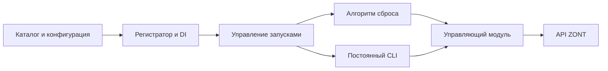

# Архитектура управляющего модуля и автономных алгоритмов

Статус: целевая архитектура по требованиям владельца от 14.10.2026,
уточнённая после [независимого ревью](../reviews/2026-10-14-autonomy-architecture.md).
Реализация ещё не начата. Здесь фиксируются контракты будущих компонентов;
текущий код описан в [контрактах приложения](contracts.md).
Правила обнаружения — [действующий алгоритм](../reference/anomaly-detection.md).
Все замечания №1–10 разобраны с владельцем и закрыты его решениями,
включая явно принятое ограничение гарантий и риски.

## 1. Состав и границы



Три публичных участника: управляющий модуль, регистратор, автономные
потребители. Каталог, supervision и отправка отдельных команд — внутренние
части этих компонентов, не отдельные сетевые сервисы. На первом этапе достаточно
одного приложения в одном процессе: алгоритмы работают в отдельных потоках.
Таймаут результата обеспечивает регистратор, остановка алгоритма кооперативная.

Управляющий модуль скрывает авторизацию, HTTP, методы двух API ZONT,
нормализацию и проверки команд. Алгоритмы потребляют его фиксированный
интерфейс и не импортируют транспорт или чужие алгоритмы.
Регистратор связывает зависимости и жизненный цикл, но не анализирует
температуры, не решает, когда сбрасывать котёл, и не рисует графики.

DI — явная передача зависимостей при создании потребителя. Отдельный
DI-фреймворк, глобальный service locator и произвольный доступ к контейнеру
не требуются. Чистый детектор остаётся отдельным от принятия решения о команде.

Текущее решение заменяет прототип целиком. Старый ZontClient и client.py
разбираются на модули авторизации, транспорта, адаптации данных и управления;
в завершённом продукте их прежнего публичного интерфейса нет. Обратная
совместимость Python API, CLI-флагов, JSON и точек входа прототипа не требуется.
Не вводить legacy-обёртки, deprecation-адаптеры и параллельный старый клиент.
Стабильный API v1 — новый контракт, а не оболочка старого. Проверенные свойства
данных и калибровка детектора переиспользуются через новые интерфейсы.

## 2. Управляющий модуль: API v1

Один экземпляр представляет одно авторизованное ЛК, включая все его приборы.
Логин/пароль/токен разрешает composition root при создании модуля; потребитель
получает готовый API. Интерактивное получение токена остаётся отдельной утилитой.
Несколько ЛК не требуются сейчас; впоследствии экземпляры можно различать
алиасом аккаунта без изменения адресации элементов внутри ЛК.

Все операции явно адресуются device_id. Идентификатор датчика, контура или
управления существует в контексте прибора: ключ — (device_id, kind, element_id).
Не выбирать первый прибор по умолчанию. Один потребитель может обращаться
к нескольким приборам, не смешивая их уставки, историю и результаты.

Фиксированный контракт нового управляющего модуля на уровне Python:

| Метод | Вход | Выход |
| --- | --- | --- |
| list_devices() | Нет | Список DeviceInfo: ID, имя, модель, online |
| describe_values(device_id) | ID прибора | Доступные ValueDescriptor: источник, имя, единицы, смысл, доступность current/history |
| read_current(device_id, value_keys=None) | Прибор и необязательный набор ключей | Snapshot: нормализованные датчики и вычисляемые значения |
| read_history(device_id, value_keys, start, end) | Ключи значений, UTC-интервал | HistoryResult: точки/ряды, фактическое покрытие и полнота |
| list_controls(device_id) | Прибор | Все обнаруженные элементы и их возможности/ограничения |
| prepare_command(device_id, control_key, action, arguments) | Элемент и объявленное действие | ValidatedCommand для предпросмотра |
| try_acquire_control(device_id, *, lease_seconds) | Прибор и бюджет критической секции с запасом; владелец определяется DI-привязкой | ControlSession с локальным expires_at либо DeviceControlBusy |
| release_control(control_session) | Собственная сессия управления | Освобождение монополии после завершения принятых команд |
| execute_command(command, control_session) | Подготовленная команда и монополия на её прибор | CommandResult после актуальной проверки и отправки |

execute_command требует действующую монополию на весь прибор и повторно
проверяет возможности и пределы: предпросмотр
может устареть. Само наличие control_key не даёт права на произвольную
команду. Потребитель может управлять каждым доступным элементом через
его actions; элементы без документированного действия возвращаются
с объяснением unavailable, а не с выдуманным HTTP-методом.

Данные — собственные неизменяемые DTO; детали io/z3k и названия методов
ZONT не становятся протоколом между компонентами. Стабильные ключи различают
измерения датчиков, целевую температуру воздуха, расчётную цель воды,
выбранный датчик, запрос worktime и состояние сброса. describe_values
объявляет именно то, что доступно конкретному прибору; произвольные
вычисляемые значения не считаются автоматически архивируемыми.

У значения сохраняются value, unit, источник, measured_at (если известен),
received_at и quality. Если API не дал время измерения, measured_at=null;
время получения не подставляется. Snapshot из нескольких запросов не
объявляется атомарным. HistoryResult сохраняет null, пропуски, реальные
метки, тип ряда (измерение/ступенчатое состояние), time_truncated и покрытие.
Нормализация не превращает неполную историю в полную и не использует будущее.

Список управления содержит и скрытые элементы; UI может фильтровать показ.
Включает kind, labels состояний, actions, min/max/step и причины ограничений.
История состояния переключателей доступна через read_history, если объявлена.

Публичные ошибки: AuthenticationError, DeviceUnavailable, UnsupportedAction,
InvalidArguments, IncompleteHistory, RateLimited и
CommandOutcomeUnknown. DeviceControlBusy означает, что монополией уже
владеет другой потребитель; ControlOwnershipRequired — отсутствие своей
действующей сессии для прибора команды. В этих случаях управляющий запрос
в ZONT не отправляется. Не включать credentials и произвольный ответ ZONT.
После таймаута управляющего HTTP-запроса результат неизвестен; повторный
запуск операции не означает повторную отправку этой же команды.

Busy и InvalidTimeout — ошибки регистратора; TimeoutError — истечение
контролируемого бюджета запуска. UnsupportedHostMode — неподдерживаемый
средой выполнения режим. CommandResult различает ответ API о принятии
команды и наблюдённое состояние устройства; одно не подменяет другое.

По решению владельца от 15.10.2026 обычный вызов исполнения синхронный:
он ждёт ответ API в пределах транспортного таймаута и даёт один из исходов:
успешный ответ API, явное отклонение (типизированная ошибка) либо неизвестный
результат (CommandOutcomeUnknown после отправки при timeout/обрыве).
Если ошибка произошла до отправки, она не объявляется неизвестным выполнением.
Успешный ответ на команду не доказывает физического результата, в частности
восстановления нагрева после сброса. Дополнительное чтение доступно потребителю,
но обязательного мониторинга каждой команды нет. Неизвестные управляющие
запросы автоматически не повторяются. Timeout регистратора отдельно означает
истечение бюджета ожидания алгоритма, не отклонение и не отмену его команд.

Составной импульс выполняет сам boiler_reset через обычные команды
управляющего API и finally. Общий сервис pulse/ticket/get_operation,
устойчивый журнал операций и восстановление импульсов после crash не
вводятся. Прежние предложения таких методов сняты решением по замечанию №4.

Имена и DTO выше фиксируют проектируемый API v1. До реализации надо закрепить
точные типы и поля в одном модуле contracts, затем проверять контрактными
тестами с подставным транспортом. Внутренние переносы текущего клиента не
должны менять потребителей. Несовместимость оформляется как новая версия API.

## 3. Независимость, команды и полномочия

Независимость означает отдельные экземпляры, конфиги, ошибки, таймеры и
жизненные циклы. Исключение одного алгоритма обрабатывается отдельно от других.
Потоки разделяют процесс; его авария и зависание общего ресурса не изолированы.
Это не
означает независимые физические котлы: команды к общему устройству могут
конфликтовать. Алгоритмы не вызывают друг друга и не разделяют изменяемую
память; связь с устройствами идёт через управляющий API.

Внутренний исполнитель управляющего модуля предоставляет монополию
по принципу мьютекса на целое устройство. В один момент времени только
один алгоритм может управлять одним устройством. Разные алгоритмы могут
управлять разными устройствами одновременно. Монополия охватывает все
управляющие элементы прибора, включая разные контуры, режимы и переключатели.
Сериализация отдельных запросов не заменяет владение на время составного
действия.

Потребитель явно вызывает try_acquire_control(device_id, lease_seconds=...).
Алгоритм выбирает срок на получение разрешения и всю критическую секцию,
включая finally, с собственным запасом; срок отсчитывается от отправки
подтверждаемого nonce. Фасад переводит локальный бюджет в R2.lease_s через
K=(1+rho)/(1-rho). Для исходного бюджета до 60/300/600 с включительно
rho=0.10/0.05/0.01 соответственно, свыше 600 с — 0.005. Ступень фиксируется
до масштабирования; точные правила — в контракте лидерства.
Если прибор занят, потребитель немедленно получает DeviceControlBusy;
скрытой очереди ожидания захвата
нет. Владелец привязан исполнителем к идентичности потребителя через DI-привязку,
а не к переданной алгоритмом строке. ControlSession действует только для
своего прибора; её нельзя передать другому потребителю. Освободить монополию
может только владелец. Повторный захват уже принадлежащего ему прибора
возвращает ту же сессию без счётчика вложенности.
Повторный захват не начинает её срок заново. После обязательных проверок
перед приёмом команды достаточно now < expires_at; отдельный бюджет на
длительность команды не проверяется. При now >= expires_at команда
отклоняется до отправки. По принятому допущению команды достаточно быстрые
и атомарные; принятые до границы выполняются и после истечения срока.

Все управляющие воздействия вне собственной действующей монополии
завершаются ControlOwnershipRequired до отправки в ZONT. Нет неявного
захвата в execute_command и исключений для отдельных управляющих методов
или finally. Чтение текущих/исторических значений, список устройств/элементов
и подготовка команды монополии не требуют и продолжают работать при занятом
приборе. Медленный прибор не держит глобальную блокировку аккаунта.
API-лимиты и транспортные таймауты учитываются управляющим модулем.
Управление временем самого алгоритма принадлежит регистратору.

Владелец удерживает монополию до завершения составного действия, включая
finally. При release_control новые команды по этой сессии больше не
принимаются; другой владелец получает прибор только после завершения уже
принятых команд. Timeout/stop алгоритма сами по себе не отзывают монополию
и не отменяют принятые команды: сначала выполняется finally, затем освобождение.
Зависший поток нельзя принудительно завершить отдельно от приложения.
Сохранение локальной монополии не продлевает аренду R2: после её истечения
новый off из finally также получает ошибку. Запросить достаточный срок
на штатное завершение — ответственность алгоритма.
Таймаут не освобождает его монополию автоматически: экземпляр остаётся stopping
до завершения finally и принятых команд. Перезапуск того же экземпляра в это
время запрещён. Принудительное завершение всего процесса не обещает off.

Гарантия действует для потребителей одного общего исполнителя. Отдельные
процессы-исполнители, разные host и прямой ЛК не разделяют локальный мьютекс.
Для отдельных исполнителей выбран условный Fischer + lease только для
выбора лидера устройства: [контракт лидерства](../reference/leader-election.md).
Лидер использует вторую строку для координации доступа. L выбирается по
ожидаемой работе; предел одного непрерывного лидерства — 20 минут от захвата,
без сброса этого предела продлениями. notes (R1) хранит лидерство и запросы /
heartbeat исполнителей. name (R2) сохраняет исходный префикс и хранит grant;
исполнители R2 только читают, назначает и продлевает его действующий лидер.
Перед записью R2 лидер подтверждает свою роль через R1; исполнитель проверяет
grant и соответствие token текущему сроку лидера. Новая роль учитывает уже
выданную аренду, отсутствие heartbeat не отзывает её немедленно.
Схема принята владельцем с известными рисками: обязательны сбор статистики
и доработки по её результатам. [Критерий и учёт](../reference/orchestration-risk.md).
99.9% остаётся ориентиром, предварительного подтверждения для принятия
владелец больше не требует. Строгая безопасность и вероятность не доказаны.
Выбор лидера не отзывает уже выданный доступ и не отменяет finally алгоритма;
новый лидер не выдаёт конфликтующий доступ до завершения владельцем либо
консервативного истечения R2. Локальный мьютекс прежнего процесса не
продлевает межклиентскую аренду и не даёт права команд после её истечения.
В опубликованном API ZONT штатный mutex/lease/CAS не найден.
Подробности и непроверенные возможности —
[исследование API](../reports/2026-10-14-zont-control-lock-api.md).

Контекст запуска содержит algorithm_id, instance_id, run_id и сигнал
кооперативной остановки; только у once есть deadline регистратора.
Он нужен для управления жизненным циклом и сопоставления
результатов, а не для отзыва команд на стороне управляющего API.
Once-алгоритм не может продлить установленный регистратором таймаут.
Секреты доступны только транспортной
части через договорённый интерфейс; DI передаёт собственные DTO и фасад.
Это разделение ответственности доверенных модулей в общей памяти, не sandbox
и не защита от произвольного Python-кода внутри того же процесса.

Для once контекст имеет один неизменяемый deadline на весь запуск.
У continuous нет deadline регистратора ни на весь срок жизни, ни на внутренние
циклы, проверки или другие действия. Алгоритм сам определяет внутреннюю
структуру работы, интервалы и свои таймауты; once timeout на него не переносится.
Регистратор управляет только запуском, явной остановкой и состоянием экземпляра,
не наблюдает внутренние циклы и не создаёт им контексты/бюджеты. Stop запрашивает
кооперативную остановку. Для управляющих воздействий continuous, как и once,
обязан получить действующую монополию. Транспортные таймауты управляющего
модуля сохраняются; это не таймауты работы алгоритма.
Ожидание пользовательского ввода CLI не ограничивает срок жизни UI и не
блокирует управление жизненным циклом других алгоритмов.

Решение о вызове управляющих методов принадлежит потребителю. У регистратора
и управляющего модуля нет обязательного общего execution_mode=preview/execute
и дополнительного разрешения реального действия. Запущенный boiler_reset
при текущем confirmed_pattern выполняет настоящий импульс сброса на 40 секунд
как своё штатное поведение, без отдельного флага execute и диалога на каждый
сброс. При регистрации и запуске действуют правила жизненного цикла из §4.

Если конкретному потребителю нужен предпросмотр или тестовый режим, он
реализует его внутри себя и не вызывает методы исполнения. prepare_command
поддерживает такой сценарий; execute_command исполняет запрошенное действие
с предусмотренными техническими проверками. В тестах
используется подставной управляющий API. Пока прототип не заменён, его ручной
CLI требует --execute; этот флаг не является требованием совместимости
нового CLI и не переносится на автономные модули. Новый boiler_cli использует
предпросмотр и явное пользовательское действие по собственному контракту.

Управляющий модуль проверяет и отправляет отдельные команды. Внутреннее
согласование конфликтующих вызовов не означает отдельного долгоживущего
исполнителя импульсов. Журналы, внешний watchdog, автоматическое восстановление
после смерти host и отдельный сервис для выключения сброса не требуются.
Монополия внутри общего исполнителя установлена решением №6; для отдельных
исполнителей выбран условный механизм лидерства, а обмен разрешениями ещё
нужно специфицировать при реализации принятой схемы. Прямой ЛК остаётся
доступным; риск конфликта с завершением импульса принят по замечанию №7 (§8).

По решению владельца команда, принятая управляющим модулем от владельца
монополии, выполняется. Без монополии команда отклоняется с ошибкой.
Модуль не проверяет активность запуска перед отправкой и не
аннулирует команду из-за последующего timeout/stop. Если реализация использует
очередь, полученная команда остаётся в ней для исполнения. Отдельного
разрешения для команд из finally нет: действует тот же обычный API.

Транспортные проверки параметров, доступности действия и ошибки ZONT
сохраняются. Правило означает исполнение запроса без отмены по жизненному
циклу, а не обещание физического успеха при ошибке API. Таймаут once-запуска
возвращает ошибку вызывающему и управляет остановкой алгоритма; он не
откатывает и не отменяет уже отправленные команды. Supervisor не ждёт
блокирующий HTTP в своём цикле отсчёта времени и возврата Timeout.

Одновременно не работают два экземпляра того же алгоритма для одной
конфигурации устройства. Разовый запуск при уже работающем постоянном
экземпляре немедленно завершается ошибкой Busy с причиной
already_running_continuous, algorithm_id и понятным сообщением:
«Разовый запуск недоступен: алгоритм уже работает в постоянном режиме».
Постоянный экземпляр не приостанавливается и не перезапускается автоматически.
Другие независимые алгоритмы допускаются; право управления конкретным
прибором определяет монополия исполнителя, не порядок их регистрации.

Остановка UI не останавливает алгоритм сброса. При штатной остановке
регистратор запрашивает отмену и даёт потребителям выполнить finally перед
закрытием управляющего API. Принудительное уничтожение процесса не имеет
гарантии выполнения finally и не покрывается восстановлением из журнала.

## 4. Каталог, регистрация и DI

Доступны все модули из доверенного каталога установленного приложения.
Каталог — явная точка добавления нового автономного алгоритма; на старте
регистратор перебирает весь каталог и исключает запрещённые algorithm_id.
Не сканировать произвольные директории и не импортировать автоматически
любой установленный Python-пакет. Каталог можно расширить позднее без
смены контракта; внешние plugins не требуются для первых двух потребителей.

Модуль предоставляет AlgorithmSpec:

- Уникальный algorithm_id, описание и поддерживаемые режимы {once, continuous}.
- Фабрику экземпляра; чтение и валидация собственной конфигурации принадлежат модулю.
- Требуемые возможности управляющего API и техническую нижнюю границу
  времени, если операция по природе не помещается в меньший бюджет.

Регистрация проверяет уникальность ID, режимы, DI-зависимости и доступные
полномочия. Конфигурацию читает и проверяет сам модуль; регистратор отражает
сообщённую им ошибку, не разбирает его настройки. Ошибка отмечается для этого модуля;
регистратор возвращает отчёт по всем модулям, без молчаливого пропуска.
Запрещённый модуль не создаётся и не стартует. Поддерживаемые режимы объявляет
spec, а автозапуск определяет регистратор по следующему правилу владельца:

| Режимы алгоритма | Состояние после регистрации по умолчанию |
| --- | --- |
| Только once | Ожидает разового запуска |
| Только continuous | Постоянный запуск начинается сразу |
| once и continuous | Зарегистрирован, постоянный запуск не начинается |

Для алгоритма с обоими режимами continuous запускается явной командой
start(algorithm_id). Настройка регистратора autostart_dual_mode=true меняет
умолчание для таких алгоритмов: они стартуют постоянно сразу после регистрации.
По умолчанию autostart_dual_mode=false. Алгоритм не выбирает эту настройку
сам и не меняет заявленные возможности при выборе пользователем режима.
В первом варианте достаточно общего переключателя; индивидуальные overrides
по модулям не требуются.

Для boiler_reset с настройками по умолчанию после регистрации доступны
run_once и start; сам по себе он не начинает постоянные проверки. После start
его run_once завершается указанной выше ошибкой до stop и завершения остановки.
Continuous-only boiler_cli сохраняет автоматический запуск при регистрации.
Если нет нужного терминала или обязательной привязки котла, состояние failed
с понятной причиной; другие модули продолжают работу.

Отдельные профили once-host/continuous-host для выбора автозапуска не нужны;
это заменяет первоначальное предложение автора после ревью. Ограничения
самой среды остаются: Cloud Functions не исполняет continuous, явный start
там даёт UnsupportedHostMode. В её конфиге continuous-only CLI запрещается
через disabled_modules, а autostart_dual_mode остаётся false.

Методы регистратора:

| Метод | Назначение |
| --- | --- |
| register_all(catalog) | Зарегистрировать все доступные, кроме запрещённых; вернуть отчёт |
| list_algorithms(mode=None) | Все зарегистрированные или поддерживающие нужный режим; spec + состояния |
| run_once(algorithm_id, timeout=None) | Запустить конкретный once, вернуть результат или типизированную ошибку |
| run_all_once(timeouts=None) | Запустить все once, независимо собрать результаты/ошибки |
| list_continuous() | Зарегистрированные continuous и состояния |
| stop(algorithm_id) | Штатно остановить continuous, дав выполниться finally |
| start(algorithm_id) | Явно запустить continuous после регистрации либо повторно после stop/failed новым экземпляром |
| close() | Прекратить приём работы и завершить приложение по политике остановки |

list_algorithms(once) включает поддерживающий оба режима модуль даже если
его continuous сейчас работает; run_once возвращает Busy с причиной
already_running_continuous. run_all_once возвращает такую же ошибку в результате
этого модуля, не пропускает его молча и не отменяет остальные запуски.
Повторный start для running идемпотентен. start для once-only — ошибка.
Остановка не удаляет регистрацию; запрет регистрации — отдельное свойство.

В первой версии register_all вызывается один раз при старте приложения;
горячая загрузка и reload кода не требуются. Регистратор не передаётся
алгоритму как service locator. DI даёт управляющий интерфейс, безопасный
вывод/логирование и нужные алгоритму часы/ввод/рендерер. Свою конфигурацию
алгоритм загружает сам из фиксированного файла; регистратор не собирает её.

По решению владельца от 15.10.2026 все алгоритмы работают потоками одного
процесса. Фабрика получает обычные Python-зависимости через конструктор;
IPC, отдельные процессы алгоритмов, сериализация DI и межпроцессный прокси
не требуются. Общий управляющий модуль обеспечивает потокобезопасность
состояния и монополии; привязка интерфейса к потребителю сохраняет его
идентичность. HTTP-транспорт и credentials остаются деталями фасада.
Короткие блокировки внутреннего состояния не держатся на время HTTP,
пользовательского ввода и всего цикла алгоритма. Таймер регистратора
не выполняет блокирующие запросы алгоритмов в своём потоке.

## 5. Режим once и владение таймаутом

Таймаут задаёт и обеспечивает регистратор через supervisor. Значение должно
быть конечным и положительным, не ниже эффективного minimum. Без явного
значения используется recommended. recommended >= minimum; неизвестный
algorithm_id, отсутствующий режим или некорректное значение отвергаются
до запуска. Нет бесконечного таймаута или права алгоритма отключить контроль.

Отсчёт monotonic начинается при принятии run_once после проверки параметров
и наличия доступного слота, до создания потока и DI. Нет скрытой бесконечной
очереди перед отсчётом: если слот не предоставлен немедленно, вернуть Busy.
В run_all_once каждый реально принятый запуск получает собственный бюджет;
ошибка одного не отменяет остальных. Общий результат содержит отдельный
исход каждого модуля, включая Busy/Timeout, а не один общий success.

На deadline регистратор/supervisor возвращает TimeoutError и выставляет
сигнал отмены. Таймер и результат не передаются под управление алгоритма.
Ожидание Future с timeout допустимо как способ прекратить ожидание результата,
но Future.cancel не останавливает уже работающий поток. Алгоритмы доверенные:
они проверяют сигнал, прерывают ожидания и выходят через finally. Ожидания
40 секунд и пятиминутной паузы используют прерываемое ожидание сигнала;
HTTP-вызовы имеют собственные конечные таймауты.

Принудительная остановка отдельного потока не поддерживается. Если он завис
или игнорирует отмену, он может продолжать существовать и удерживать монополию;
это явное ограничение принятой модели. Полной изоляции от зависания процесса
или общего ресурса нет. Возврат TimeoutError не считается доказательством
фактической остановки алгоритма.

Таймаут включает bootstrap, получение данных, ожидание команд, алгоритм,
обычные API-проверки и получение результата. После TimeoutError алгоритм
должен прекратить основную работу и выполнить finally; это не продлевает
таймаут результата. Пока поток ещё работает, экземпляр остаётся stopping
и повторно не запускается. Монополия не передаётся другому алгоритму до
завершения cleanup и принятых команд. finally может начать отправку off
после возврата TimeoutError. Если ожидание остановки закончилось раньше,
состояние stopping сохраняется; принудительного kill потока не происходит.

Управляющий API должен оставаться пригодным для завершающей команды при
штатной отмене/остановке; его нельзя закрыть до finally. Принудительный kill,
аварийная смерть процесса, выключение машины и жёсткое завершение облачного
runtime не покрываются этой гарантией. Уже отправленный HTTP-запрос может
завершиться позже; отмена вычислений не откатывает внешнее действие.
Ошибка выключения сброса отражается явно, без утверждения об успешном off.

Continuous работает в своём потоке того же процесса. stop выставляет сигнал
отмены, состояние становится stopping до выхода через finally. start/restart
не создаёт второй экземпляр, пока предыдущий поток не завершён. Непойманное
исключение отмечается failed; бесконечного автоматического restart нет.
Повторный старт явный. Повторять отдельные чтения внутри здорового continuous
можно по политике модуля с учётом API-лимитов. Штатное close оставляет
управляющий API доступным до завершения cleanup; зависший поток может
помешать полному завершению приложения, и это не маскируется как успех.

## 6. Конфигурация регистратора и модулей

По решению владельца конфигурация — внутреннее дело каждого алгоритма,
включая CLI. В каталоге config/ корня проекта используется фиксированное имя
для каждого модуля: config/boiler_reset.json и config/boiler_cli.json.
Модуль сам читает файл, определяет схему, проверяет значения и сообщает
понятную ошибку с путём при отсутствии или некорректности обязательного
конфига. Регистратор не имеет module_configs и не определяет порядок
переопределения настроек алгоритма. Общие --config и ZONT_CONFIG не вводятся.

В первой версии каталог config/ ищется относительно рабочего каталога;
приложение из checkout и установленного wheel запускается из корня проекта
с этим каталогом. Нет поиска вверх по дереву или относительно site-packages.
Для офлайн-тестов путь/чтение подставляются через обычные зависимости.

RegistryConfig из фиксированного config/registry.json содержит только
собственные настройки регистратора:

- autostart_dual_mode: boolean, по умолчанию false; при true регистратор
  запускает continuous сразу после регистрации алгоритмов с обоими режимами.
  На continuous-only и once-only этот переключатель не влияет.
- disabled_modules: множество algorithm_id, которые нельзя регистрировать.
  Отсутствие ID в этом списке допускает регистрацию всех доступных модулей.
- once_timeouts: для once-модулей пары minimum_seconds/recommended_seconds.
  Эффективный minimum — максимум конфигурации и технического minimum из spec.
  Неполные/некорректные пары дают ошибку конфигурации; не задавать скрытые
  произвольные таймауты. Если доступный once не имеет пары — он failed,
  требуется добавить параметры перед запуском.

Минимальный пример структуры; числа здесь показывают форму и не являются
измеренными эксплуатационными рекомендациями:

```json
{
  "disabled_modules": [],
  "autostart_dual_mode": false,
  "once_timeouts": {
    "boiler_reset": {"minimum_seconds": 120, "recommended_seconds": 180}
  }
}
```

Содержимое config/boiler_reset.json (схемой владеет boiler_reset):

```json
{
  "device_id": 700877,
  "circuit_id": 20496,
  "air_sensor_id": 8207,
  "coolant_sensor_id": 8429,
  "reset_control_id": 8832,
  "check_interval_seconds": 60
}
```

Содержимое config/boiler_cli.json (схемой владеет boiler_cli):

```json
{
  "devices": [700877],
  "graphs": ["air_actual_target", "coolant_actual_target"],
  "controls": [{"device_id": 700877, "kind": "switch", "element_id": 8832}]
}
```

Общие настройки управляющего модуля (контакт API, транспорт, координация и
статистика) находятся отдельно в config/controller.json. Их загружает
управляющий модуль через composition root; алгоритмы не разбирают параметры
ZONT и не создают собственный транспорт. Это не конфигурация алгоритмов.
Токен остаётся только в ZONT_TOKEN, в JSON секретов нет.

Старый control --execute и его флаги/переменные окружения не являются
контрактом нового CLI. Его код и прежняя точка входа удаляются, управление
переходит в boiler_cli через DI-фасад с действующей сессией. Контакт,
HTTP-таймауты и координацию задаёт controller.json, параметры CLI — его
boiler_cli.json. Адаптер совместимости и приоритеты старых overrides не нужны.
Для исполнения отсутствие обязательного файла даёт ошибку до сети с точным
путём и инструкцией. Новые --help/--version и чистая подготовка команды не
требуют файлов, токена, клиента или запуска алгоритмов.

Каждый компонент валидирует свой конфиг до своих внешних действий.
Смена конфига постоянного модуля применяется после stop/start;
live reload не требуется. Запрещённый модуль не читает свой файл.
Основание — [решение по конфигурации](../history/2026-10-15-algorithm-configuration.md).
Графики и controls CLI выбираются из возможностей API, не из названий UI.
Технический minimum сброса включает 40 секунд плюс бюджеты обязательных
чтений/включения/выключения/проверок; одного timeout=40 недостаточно.

## 7. Автономный модуль boiler_reset

Режимы: once и continuous. Зависимости: управляющий интерфейс и свой конфиг.
Детектор используется как чистая логика по истории; запрограммированная
политика действия является отдельным слоем над результатом.

Одна проверка:

1. Прочитать для привязанного прибора 45 минут температур, целей, worktime,
   выбранного датчика и состояния сброса, включая события между минутами.
   Пригодность оценивает действующий детектор: старый разрыв допустим, если
   после него накопились достаточные пригодные точки. Не вводить условие
   «45 минут без единого пропуска». Сокращённый диапазон, неизвестное состояние
   сброса и непригодные последние измерения сохраняют прежний unknown.
2. Получить текущее решение прежнего калиброванного алгоритма. Только
   state_at_period_end=confirmed_pattern допускает сброс. warning, anomaly=true
   без confirmed_pattern или старое событие events не достаточны.
3. Получить монополию на прибор через try_acquire_control с lease_seconds
   на получение grant, повторные проверки, on, 40 секунд и off с запасом;
   занятый прибор
   даёт понятную ошибку, без отправки команды. Уже под монополией повторно
   проверить online и актуальное состояние сброса. Если сброс
   уже включён, считать отключение намеренным и не выключать чужой сброс.
   Правила временных меток и пригодности остаются в действующем детекторе,
   без дополнительного архитектурного допуска истории или срока решения.
   По решению №10 наличие истории позволяет запустить существующий детектор;
   ручная смена условий через ЛК или наш CLI не требует автоматического
   отзыва/пересчёта подготовленного решения. Человек знает последствия
   вмешательства и принимает риск. Атомарность с внешним ЛК не обещается.
4. В самом алгоритме выполнить try/finally: включить сброс и ожидать
   40 секунд с возможностью штатной отмены; в finally немедленно отправить
   выключение сброса, включающее котёл. При отмене/исключении не дожидаться
   остатка 40 секунд. Ошибка выключения видна в результате; успешный сброс
   не доказывает восстановления нагрева. Монополия удерживается на протяжении
   on, ожидания и off в finally, затем освобождается во внешнем finally,
   в том числе при ошибке off. При отказе захвата или проверок до попытки on
   команда off не посылается. На пятиминутную паузу монополия не удерживается.

В continuous интервал check_interval_seconds задаётся в module config.
Одна проверка за раз, по monotonic расписанию; если предыдущая заняла дольше
интервала, пропустить пропущенные слоты, без догоняющего потока команд.
Следующая оценка снова разовая по своему окну. Остановка запрещает новые
проверки/импульсы; существующее обязательство выключить сброс сохраняется.

Политика повторных проверок — ответственность самого boiler_reset.
Согласованные правила для continuous и once находятся в
[договорённостях алгоритма](../reference/boiler-reset.md). Архитектура не
вводит для этого счётчик попыток, guard/rearm, обязательное хранилище или
ручное повторное разрешение. Результат сброса и восстановление нагрева
по-прежнему различаются; критерии самого детектора не меняются.

## 8. Импульс сброса: срок и завершение

По решению владельца завершение принадлежит самому boiler_reset:
finally немедленно выключает сброс и включает котёл при штатной остановке
или исключении. Ожидание 40 секунд штатно прерывается; отмена не должна
заставлять ждать остаток импульса или пятиминутную паузу.

Граница гарантии — штатная остановка и исключения, при которых finally
выполняется. Принудительный kill, смерть процесса/host, выключение питания
и жёсткое прекращение функции вне этой границы. Дополнительных журналов,
watchdog, независимого исполнителя и восстановления незавершённых импульсов
не требуется. Контракт не обещает физическое выполнение команды при ошибке
API/недоступности устройства; такая ошибка должна быть явно возвращена.

Правила самого модуля — [описание boiler_reset](../reference/boiler-reset.md).
Штатное закрытие управляющего API следует после завершения finally.
По решению владельца от 15.10.2026 прямое управление через ЛК сохраняется.
Такие вмешательства редки, контролируются человеком, который принимает
риск и может исправить результат. После попытки включения сброса алгоритм
сохраняет обычное завершение через finally, включая попытку off при
неизвестном исходе on. Ручные команды не отменяют это завершение; повторный
ручной on во время импульса может быть отменён автоматическим off. Повторное
чтение состояния не объявляется доказательством автора или намерения.
Если сброс включён до начала автоматического импульса, алгоритм его не трогает.

В ЛК предусматривается видимая индикация «управление занято» через служебный
суффикс name/R2 с сохранением исходного названия. Она относится к активному
разрешению исполнителя, а не просто наличию лидера, и помогает человеку
решить, когда вмешиваться. Это информация для человека; она не блокирует
команды прямого ЛК. Дополнительного диалога, запрета ручного управления или
отдельного механизма определения автора команды не вводится. Замечание №7
закрыто принятием этого риска; индикация пока является требованием к реализации.

## 9. Автономный модуль boiler_cli

Режим: только continuous. Через тот же контракт регистрации он стартует
после регистрации, останавливается и запускается повторно. Это постоянный
потребитель с UI, а не чистый детектор; собственная логика нагрева ему не нужна.

Показывает текущие данные разрешённых устройств, обновляя их раз в 60 секунд.
Чтение и пользовательский ввод не блокируют друг друга. Пропуск или ошибка
чтения показываются с давностью/quality, не заменяются последним значением
без пометки. Только один экземпляр владеет конкретным терминалом.

Запрашивает исторические графики за заданный пользователем интервал,
проверяет timezone, порядок дат и доступность рядов. Перечень graphs
в собственном config/boiler_cli.json задаёт набор пар/рядов (например, воздух факт/цель, вода факт/цель),
перечень devices/controls — доступные устройства и команды. Разрешённый
набор пересекается с актуальными возможностями управляющего API.
Отображение графиков — адаптер UI, не метод transport и не обязанность
регистратора. Формат терминал/внешнее изображение выбирается при реализации.

Ручная команда показывает адресат, действие и предпросмотр перед явной
отправкой. Числовые границы и доступность проверяет управляющий модуль.
Для отправки CLI получает монополию на выбранный прибор и освобождает её
после команды. При DeviceControlBusy показывает понятную ошибку, не обходит
исполнителя и не прерывает другого владельца. Просмотр данных и ожидание
ввода не удерживают монополию на всё время жизни CLI.
Показать ошибку конфликта/неизвестного исхода, не писать «успешно» по одному
принятому запросу. CLI не создаёт собственный транспорт и не управляет
остальными алгоритмами скрытыми side effects.

Без интерактивного терминала регистрация CLI даёт failed. Для headless
запуска его явно включают в disabled_modules; silent fallback в другой
тип автономного алгоритма не требуется.

## 10. Размещение и запуск

Предлагаемая структура внутри существующего пакета:

| Путь | Ответственность |
| --- | --- |
| controller/contracts | Стабильные DTO/ошибки/API потребителя |
| controller/auth | Авторизация и выдача токена, без монолитного клиента |
| controller/transport | Внутренний HTTP-транспорт с типизированными исходами |
| controller/zont | Внутренний адаптер API ZONT и нормализации |
| controller/service, controller/ownership | Фасад, монополия на устройство, проверка и отправка команд |
| autonomy/contracts | AlgorithmSpec, режимы, результаты и состояния |
| autonomy/catalog | Единственная точка подключения алгоритмов |
| autonomy/registry | Конфигурация, регистрация и DI |
| autonomy/supervisor | Потоки, таймаут результата once и кооперативный stop/start; без контроля внутренних действий continuous |
| algorithms/boiler_reset | Проверка истории и политика запроса импульса |
| algorithms/boiler_cli | Постоянный UI, ввод и рендереры |
| application | Composition root для локального/облачного режима |

Это границы ответственности, не требование создать сразу десять пакетов
с пустыми интерфейсами. Начать с небольшого числа модулей и выделять
файлы по реальной сложности. Прототип заменяется новым приложением без
обязательств совместимости. Основные точки входа — zontcontrol и
python -m zontcontrol, обе через application. Утилита получения токена
использует выделенный auth-модуль. Старые client.py, cli.py, control.py
и entrypoint zontcontrol-control удаляются после переноса нужного поведения;
готовый продукт не содержит fallback на них. Скрипты и тесты переводятся
на новую структуру. Исходные файлы могут временно оставаться между TDD-этапами,
но это не поддержка старого API и не архитектурно завершённая версия.

Локальный долгоживущий host поддерживает оба режима. Yandex Cloud Functions
подходит для once; постоянный CLI и бесконечный цикл не помещаются в модель
функции. Continuous в облаке требует долгоживущего контейнера/VM либо
остаётся локальным. Scheduler функции — повторные once, не continuous.
60s из первоначального плана — исходная оценка read-only функции, не бюджет
полной проверки плюс импульс 40s и отправку off. Время корректного
завершения надо уложить до жёсткого timeout облачной платформы; при её
принудительном kill finally не гарантируется. Внешний механизм не добавляется.

## 11. Критерии приёмки реализации

- Два прибора с совпадающими element_id не смешивают чтения и команды.
- Доступные current/history/controls следуют возможностям API, включая null,
  скрытые элементы, расчётные значения и неполный архив.
- Новый модуль добавляется только в каталог; register_all регистрирует все
  разрешённые и проверяет DI. Continuous-only стартует сразу; dual-mode
  по умолчанию ожидает команды start, а при autostart_dual_mode=true стартует.
- Регистратор возвращает Timeout по своему таймеру, даже если поток ещё
  не завершён. Кооперативная остановка прерывает ожидания и выполняет finally;
  некоперативный поток не объявляется остановленным, остаётся stopping и
  не перезапускается. Принудительная остановка и изоляция процесса не обещаются.
- Алгоритмы получают интерфейс обычным DI в одном процессе; межпроцессного
  протокола нет. Общие состояния контроллера и владение потокобезопасны.
- Только владелец монополии управляет прибором; без сессии, с чужой,
  освобождённой или выданной для другого прибора сессией — ошибка без сетевой
  команды. Два алгоритма могут одновременно управлять разными приборами.
- Чтения/история/предпросмотр доступны при занятом приборе. Два претендента
  на один прибор не получают монополию одновременно; release не позволяет
  новому владельцу обогнать ранее принятые команды предыдущего.
- Принятая от владельца монополии команда исполняется и при последующем timeout/stop;
  команды из finally используют тот же API. Ошибки API и неизвестный исход
  явно отражаются; таймаут запуска не считается отменой команды.
- У синхронной команды различимы успешный ответ API, явная ошибка и неизвестный
  результат после отправки. Автоматического повтора и обязательного отдельного
  слежения за каждой командой нет; API-успех не называется восстановлением котла.
- Штатный stop/исключение во время импульса прерывают ожидание и приводят
  к немедленной попытке off из finally; управляющий API закрывается после
  завершения finally и освобождения монополии. Проверены ошибка команды off,
  удержание монополии до конца импульса и выбранная граница гарантии,
  без обещания восстановления после crash/kill.
- Once и continuous одного котла не создают два импульса; CLI-конфликт
  разрешён явно. Политика повторных проверок принадлежит модулю сброса.
- UI обновляется раз в минуту, не блокирует ввод, запрашивает разрешённые
  графики и управляет только выбранными доступными элементами.
- История оценивается действующим детектором с сохранением его правил и
  unknown; нового архитектурного допуска данных, идеальных 45 минут и
  автоматической инвалидизации решения из-за ручных изменений нет.
- Активный grant отражается в ЛК как занятое управление с сохранением
  исходного имени. Ручной повторный on во время импульса не отменяет off из
  finally; включённый до импульса сброс не трогается. Принятый риск прямого
  ЛК не маскируется обещанием технической блокировки его команд.
- Принятая координация R1/R2 соблюдает роли записи и обязательные проверки;
  статистика фиксирует выдачи, ожидания, смены лидера, потери заявок, ошибки,
  превышения Delta, конфликты и неизвестные исходы. Она не обещает заранее
  99.9%; доработки проверяются по версиям протокола.
- Штатное завершение с finally отличено от принудительного kill/смерти host;
  журналы/watchdog и независимый исполнитель не требуются.

Дополнительно после ревью: dual-mode с умолчаниями не создаёт continuous
поток, а после явного start разовый вызов даёт понятную ошибку; общий
preview/execute не требуется, boiler_reset исполняет заданное действие;
полученная от алгоритма команда не отменяется по deadline/stop, и finally
использует обычный управляющий API; общий guard повторов и
восстановление импульсов по журналу не вводятся. Решение №6 вводит монополию
на прибор в общем исполнителе; межхостовой выбор лидера описан отдельно,
текущая схема R1/R2 принята со сбором статистики и развитием по ней,
условная аренда лидера не считается доказанной монополией исполнителей.
По №7 прямой ЛК сохранён с индикацией занятости и принятым человеком риском
конфликта с finally. По №10 история служит входом действующего детектора;
дополнительные ограничения и пересчёт из-за ручных вмешательств не вводятся.

Независимое ревью первого проекта и реакция автора фиксируются отдельно
в docs/reviews. Все десять замечаний закрыты решениями владельца; запись этого
документа не означает практической реализации или физической проверки.
