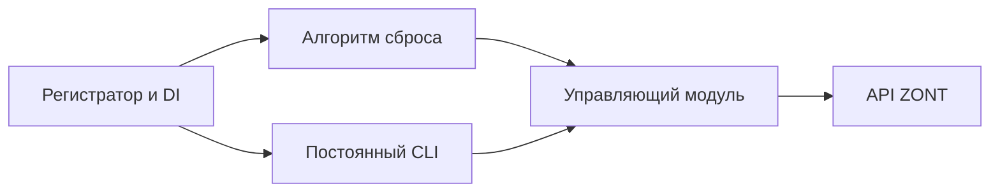

# Архитектура управляющего модуля и автономных алгоритмов

Решение об удалении синхронизации заменяет прежние договорённости о монополии:
[основание и границы](../history/2026-10-20-remove-synchronization.md).
Точный Python-интерфейс — [контракты](contracts.md).

## 1. Состав и границы

application создаёт один транспорт, адаптер и ControllerService на аккаунт.
Регистратор передаёт этот контроллер фабрикам алгоритмов обычным DI.
Новый запуск получает новый экземпляр алгоритма, но тот же контроллер.
Потребители не знают о токене, HTTP, widget/full API и нормализации.
Все операции адресуют device_id: один ЛК может содержать несколько приборов.

controller/contracts задаёт неизменяемые DTO и Protocol Controller API v2.
ReadControllerService отвечает за данные, историю и preview;
ControllerService добавляет execute_command и write_notes. Оба фасада читают
notes через read_notes. ZontAdapter переводит операции
в запросы ZONT, HttpTransport проверяет ответы и ограничивает время HTTP.
create_read_controller создаёт контроллер для чтения и предпросмотра без метода отправки команд.
create_controller — контекстный менеджер полного контроллера с собственным
транспортом, без регистратора и алгоритмов. При выходе он закрывает транспорт.
Чистый детектор и преобразование его входов отделены от управляющих воздействий.

Путь отопления: Controller.read_history → from_controller_history →
HeatingHistory → monitor.history_samples → HeatingSample → NoHeatDetector.
heating содержит только неизменяемые предметные типы и stdlib; heating_adapter
выбирает точные привязки Controller DTO без I/O и конфигурации алгоритма.
Monitor зависит от предметной истории, детектора и профиля, не от Controller,
алгоритмов или scripts. JSON/ISO архивов разбирает scripts/heating_archive;
исследовательский heating_window строит те же типы из объединённых рядов.
Адаптеры сохраняют доступные значения и метаданные, не содержат детекцию.

В runtime нет пакета coordination, лидера, аренды, R1/R2, control session,
очереди запросов монополии или локального мьютекса прибора. Контроллер не
читает и не пишет name/notes для служебной координации. Между потребителями
нет персональных control bindings. Команды разным и одному прибору могут
выполняться одновременно; конфликты не разрешаются приложением.
Служебные блокировки защищают состояние регистратора и терминал, но не
охватывают HTTP-команды и не предоставляют монополию на прибор.

ZontAdapter один раз при первом успешном адресном чтении прибора пытается
обновить собственный суффикс времени подключения UTC в name. Исходное имя
сохраняется. Это диагностическое побочное действие с метаданными
для всех клиентов, включая create_read_controller; методы отправки команд
в интерфейс для чтения не добавляются. Просмотр всего аккаунта/создание приложения не меняет имена.
Ошибка отметки не блокирует чтение/управление, запись не повторяется.
read_notes также отмечает подключение, write_notes полностью заменяет только
notes без чтения прибора, проверки online или изменения имени. В облаке notes
служит историей трёх завершённых логов, а не механизмом координации.

## 2. Данные и команды

Controller предоставляет list_devices, describe_values, read_current,
read_history, list_controls, prepare_command, execute_command, read_notes и write_notes.
Ключ значения — device_id/kind/element_id/field; ключ управления —
device_id/kind/element_id. Первый прибор по умолчанию не выбирается.
Snapshot/HistoryResult сохраняют источник, качество, null, реальные метки
и неполноту; received_at не подменяет отсутствующее measured_at.
Снимок из нескольких запросов не объявляется атомарным.

prepare_command проверяет адрес, действие и аргументы и возвращает preview.
execute_command(command) заново читает актуальные возможности и online,
проверяет пределы, затем отправляет ровно одну команду. Нет захвата управления,
ожидания разрешения или release. Ответ синхронный: успех API, явная ошибка
или неизвестный исход после отправки. Неизвестный исход не повторяется
автоматически. Успех API не доказывает физический результат.

## 3. Регистратор и запуск

Явный каталог AlgorithmSpec задаёт factory, once/continuous, capabilities и
minimum_seconds. Автосканирования модулей и service locator нет.
BOILER_RESET_SPEC доступен без импорта CLI. builtin_specs() лениво загружает
BoilerCLI и возвращает оба локальных модуля; create_application(catalog=None)
выбирает эти defaults. Явный каталог, включая пустой, используется как передан.
disabled_modules исключает модуль до чтения его конфигурации и DI.
Регистрация проверяет конструктор без запуска работ или HTTP-команд.
Каждый новый запуск создаёт свежий экземпляр в своём worker-потоке.

Для стандартного локального приложения достаточно create_application(),
для once без CLI — create_application(catalog=(BOILER_RESET_SPEC,)).
Причины ленивого каталога и переход с прежнего внутреннего импорта —
[история выпуска 0.5.0](../history/versioning.md#выпущен-050-21102026).

Once имеет deadline результата, контролируемый регистратором. По таймауту
caller получает AlgorithmTimeout, модуль получает Event отмены и заканчивает
finally. Поток не убивается; до его завершения состояние stopping запрещает
повторный запуск того же алгоритма. Попытка once при работающем continuous вызывает
AlgorithmBusy с сообщением о работе алгоритма в постоянном режиме. Continuous не имеет deadline регистратора: циклы,
интервалы и внутренние таймауты принадлежат самому модулю.

Continuous-only запускается после регистрации. Для dual-mode по умолчанию
continuous не стартует; нужен явный start или autostart_dual_mode в конфиге.
Независимые алгоритмы запускаются в одном процессе с потоками и обычным DI.
Их жизненный цикл не сериализует управление общим прибором.
Контроллер передаётся напрямую; фабрика создаёт только экземпляр алгоритма.
Контекст запуска содержит ID алгоритма, Event отмены и deadline once.

## 4. Сброс котла

boiler_reset получает общий T и читает отдельно telemetry без reset за 46 минут
и reset за 120 минут. Ответы отдельно преобразует прежним heating_adapter;
предметный вход собирает внутри алгоритма, сохраняя основное окно и телеметрию
и добавляя целую reset-серию с объединением метаданных. Интерфейсы Controller
и адаптера не расширяются. Правила пригодности —
[справочник детектора](../reference/anomaly-detection.md#2-пригодность-данных).
Monitor строит прежние 45 минутных отсчётов: температуры интерполирует по
соседним исходным измерениям с интервалом <=120 с; без правой опоры допускает
единственный сдвиг конца сетки на минуту. Профиль детектора не изменён;
различия входной нормализации — [отчёт](../reports/2026-10-20-typed-heating-regressions.md).
Только текущий confirmed_pattern разрешает импульс. Перед on
boiler_reset проверяет online и состояние переключателя; уже включённый сброс не трогает.
Далее on, прерываемое ожидание 40 с и немедленная попытка off в finally,
включая неизвестный исход on. После off в continuous — пауза 5 минут;
once заканчивается без этой паузы, рекомендуемый внешний период — 15 минут.
Регистратор и контроллер не вводят общих guard/rearm, журналов или watchdog.
Подробности и результаты калибровки — [справочник](../reference/boiler-reset.md).

## 5. CLI

boiler_cli — continuous-only потребитель: текущие данные раз в минуту,
SVG-графики за указанный интервал и команды по allowlist собственного конфига.
Без --execute команда показывает только preview. С --execute вызывает тот же
execute_command, что и автономные алгоритмы. CLI не управляет регистратором.
Медленное чтение не блокирует ввод; при остановке модуль ждёт reader-поток.

application.main настраивает текстовый logger zontcontrol для обоих входов:
console script и python -m zontcontrol. Импорт и create_application не
настраивают логирование. configure_yc_logging отдельно включает JSON stdout
для облачного входа; собственный handler заменяется при повторной
настройке, чужие handlers и корневой logger сохраняются. События once и on/off
содержат безопасные метаданные без API-ответов и текста исключений; принятие
off API не доказывает физическое восстановление. Вывод CLI остаётся UI.
Cloud handler включает tee Python stdout/stderr на время вызова. Имеющиеся
StreamHandler, направленные в эти потоки, временно используют tee: в том числе
обработчики корневого и отдельных логгеров, независимо от propagate. Их форматы, уровни и
состав не меняются. После завершения рабочего потока и его finally, а затем закрытия транспорта
облачный обработчик возвращает строку log и данные результата алгоритма целиком,
не разбирая события алгоритма.
При ошибке лог входит в JSON RuntimeError. В finally исходные потоки
восстанавливаются, включая handlers, созданные внутри вызова; буфер закрывается.
Вне вызова накопления нет, тёплые вызовы не делят буфер. Вызов завершается исключением;
настроенные повторы платформы сохраняются; код не пишет upstream текст. Прямой вывод через файловые дескрипторы ОС или нативный код,
файловые обработчики логов и платформенные сообщения вне процесса не захватываются.

## 6. Конфигурация и завершение

Из корня проекта используются config/controller.json, config/registry.json и
config/<algorithm_id>.json. Конфиг алгоритма читает и проверяет сам модуль.
Общих --config/ZONT_CONFIG и таблицы module_configs у регистратора нет.
Controller config содержит только contact и http_timeout_seconds.
Токен локально поступает из ZONT_TOKEN, в облачном профиле — из Lockbox.

Shutdown запрещает новые старты алгоритмов, посылает отмену всем worker,
ждёт их finally и лишь затем закрывает транспорт. close(wait_timeout) может
вернуть False, оставив ресурсы открытыми для заканчивающихся модулей.
Внешние потребители app.controller() сами завершают свои вызовы до app.close().
Отдельного трекера внешних команд, сессий или cleanup-workers нет.
Kill/смерть процесса не покрыты гарантией finally. Новые зависимости,
IPC и БД не добавляются.

## 7. Облачный once

handler.handler экспортирует zontcontrol.cloud.handler без работы при импорте.
На вызов создаётся свежее Application с единственным BOILER_RESET_SPEC в режиме
once. Event не выбирает устройство или режим. Handler один раз вызывает
run_once('boiler_reset', timeout=300), ждёт worker/finally и закрывает транспорт
до возврата результата. Профиль берётся из deploy/cloud-config при сборке ZIP;
локальные CLI, continuous и рабочие конфиги в архив не входят.
До закрытия handler получает прежнюю историю notes; после полного shutdown
и конечной записи в лог фиксирует тот же log, который вернётся в ответе.
Отдельный короткий create_controller публикует JSON-массив из нового лога и
двух предыдущих, без повторного запуска алгоритма или служебного success-лога.
Ошибка публикации сообщается в notes_saved/notes_error и не меняет основной исход.
Порча/чужой формат notes не затирается; конкурирующие клиенты могут потерять
запись при ротации, без восстановления удалённой координации.

Workflow публикует только проверенный актуальный master через OIDC и pinned
секрет. Версии деплоя, наблюдённые вызовы и границы внешней проверки —
[отчёт](../reports/2026-10-21-yandex-cloud-acceptance.md).
Параметры и внешняя приёмка — [контракт деплоя](deployment.md).
